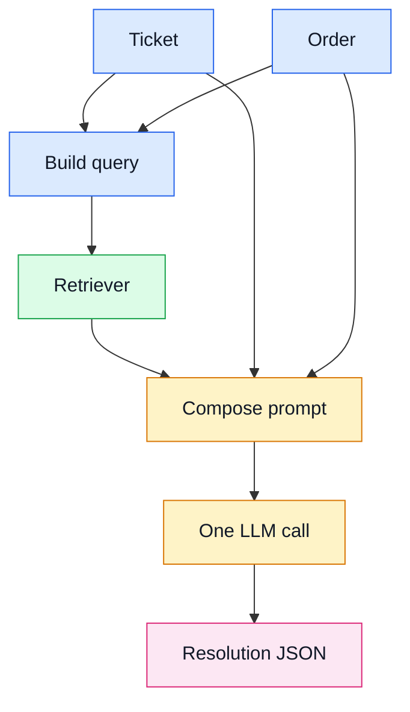
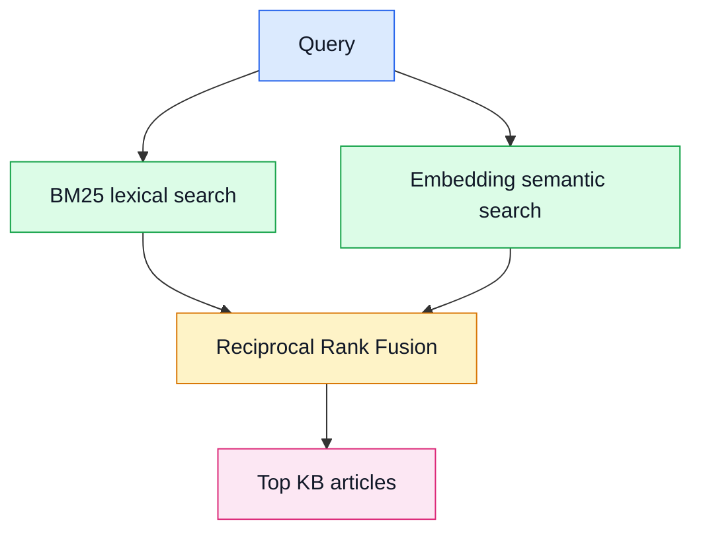
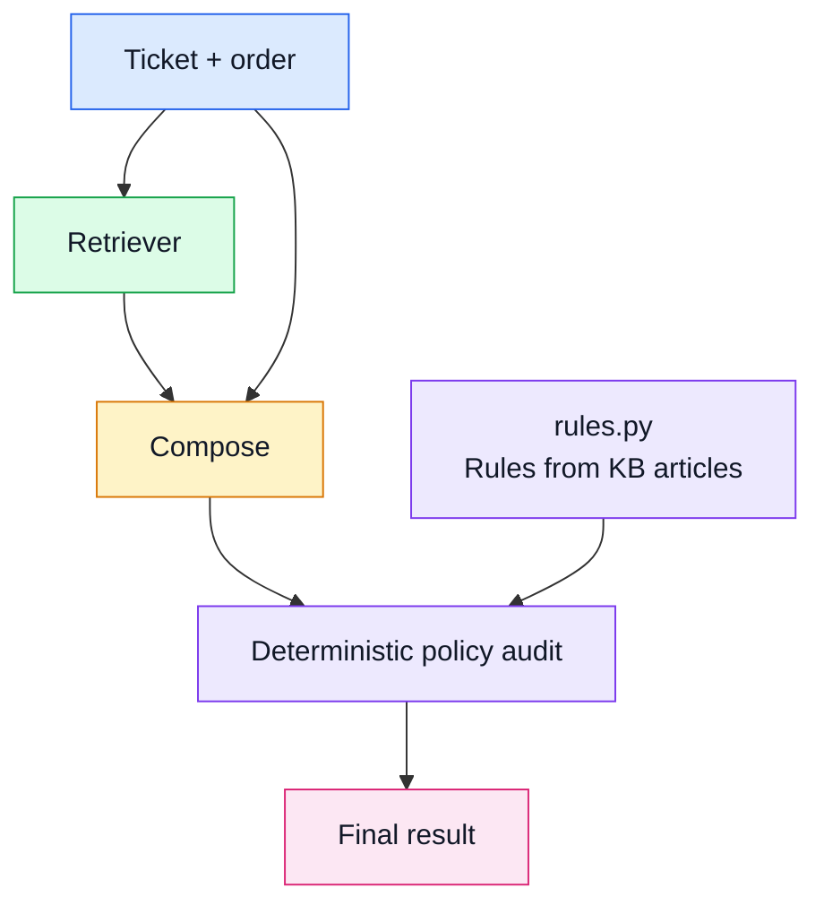
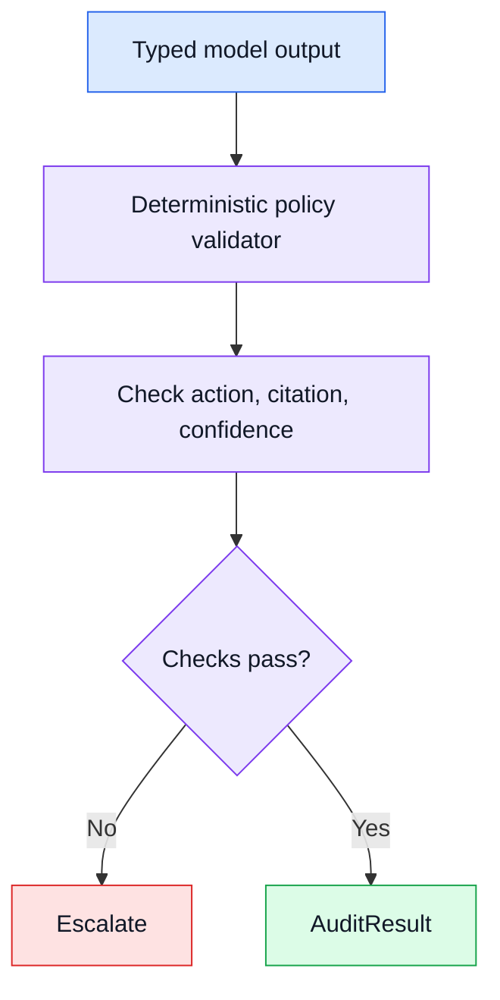

# ShopAssist Design

## Submission

- Design document: `[Add design document link]`
- Video explanation: `[Add video explanation link]`

## Solution:

## 1. Question 1

### Architecture-Based Changes
1. LLM based KB article selection →
Local hybrid retriever using BM25 (lexical) and embeddings (semantic) search with reciprocal rank fusion (RRF)
2. Full article blobs →
Relevant articles

### Prompt Engineering
3. 4 redundant few-shot examples →
2 concise examples
4. Verbose reasoning →
Only the required JSON
5. Run ID removed from the prompt

### Design

Question1 uses local hybrid retrieval followed by one focused LLM call.

### Retriever

Implementation: [question1/agent.py](https://github.com/aditya-prasad1/Induseuro-labs-intern/blob/main/question1/agent.py)

### Per-ticket points

| Ticket | Points |
|---|---:|
| `T-1001` | 1,704 |
| `T-1002` | 1,575 |
| `T-1003` | 1,515 |
| `T-1004` | 1,476 |
| `T-1091` | 1,566 |
| **Average** | **1,567.2** |

## 2. Question 2

### Architecture-Based Changes

1. Multi-node pipeline with multiple LLM calls →
Triage/Retriever (local) → Compose (LLM) → Audit
(local)

2. 4 LLM Calls →
1 LLM Call

3. LLM-based KB article selection →
Local hybrid retriever using BM25 (lexical) and
embeddings (semantic) search with reciprocal rank fusion (RRF)

4. LLM-based audit →
Deterministic boundary rules from the KB articles

### Prompt Engineering

3. 4 redundant few shot examples →
2 concise examples
4. Verbose reasoning →
Only the required JSON
5. Run ID removed from the prompt
6.  Second triage call removed 

### Overall design

Question2 keeps the pipeline stages explicit:

### Deterministic audit

Implementation: [question2/agent.py](https://github.com/aditya-prasad1/Induseuro-labs-intern/blob/main/question2/agent.py).
Rules are defined from the KB articles in
[question2/rules.py](question2/rules.py).

### Per-ticket points

| Ticket | Points |
|---|---:|
| `T-1001` | 1,752 |
| `T-1002` | 1,623 |
| `T-1003` | 1,563 |
| `T-1004` | 1,524 |
| `T-1091` | 1,614 |
| **Average** | **1,615.2** |

## Further Improvements

1. **Summarize KB articles:** Send only relevant policy facts to the LLM to
   reduce token usage.
2. **Cache results:** Reuse retrieval and embedding results for recurring queries.
3. **Skip unnecessary nodes:** Bypass later pipeline stages for high-confidence
   deterministic cases.

