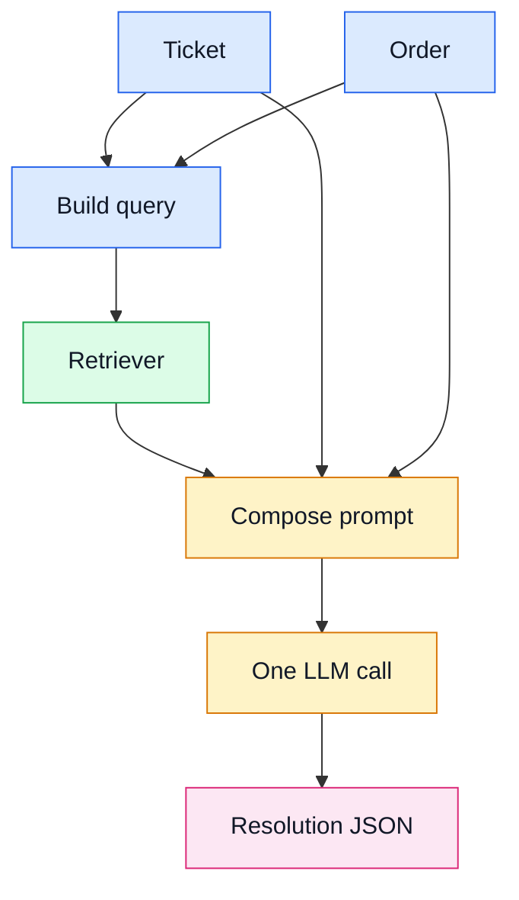
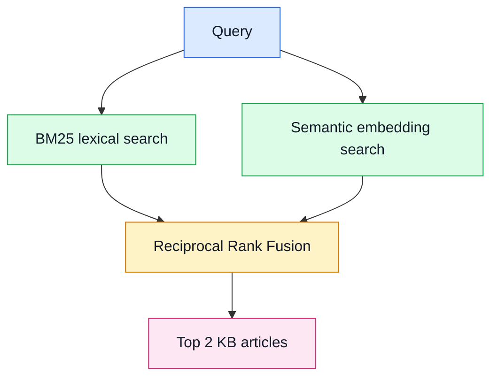

# Question 1 Submission

## Changes to `agent.py`

- Replaced LLM-based article selection with a local hybrid retriever that combines
  BM25 (lexical) and embeddings (semantic) search using reciprocal rank fusion
  (RRF).
- Removed the run ID from the prompt.
- Reduced the few-shot prompt to two concise examples.
- Requested only the resolution JSON instead of verbose reasoning.

## Design

Question 1 uses local hybrid retrieval followed by one focused LLM call.

## Retriever

Implementation: [question1/retriever.py](question1/retriever.py)

## Per-call billing breakdown

Measured using the current implementation:

| Ticket | Points |
|---|---:|
| `T-1001` | 1,704 |
| `T-1002` | 1,575 |
| `T-1003` | 1,515 |
| `T-1004` | 1,476 |
| `T-1091` | 1,566 |
| **Average** | **1,567.2** |

This design is averaging **1,567 points per
ticket**. 
Every public ticket is below the **3,000-point target**.

