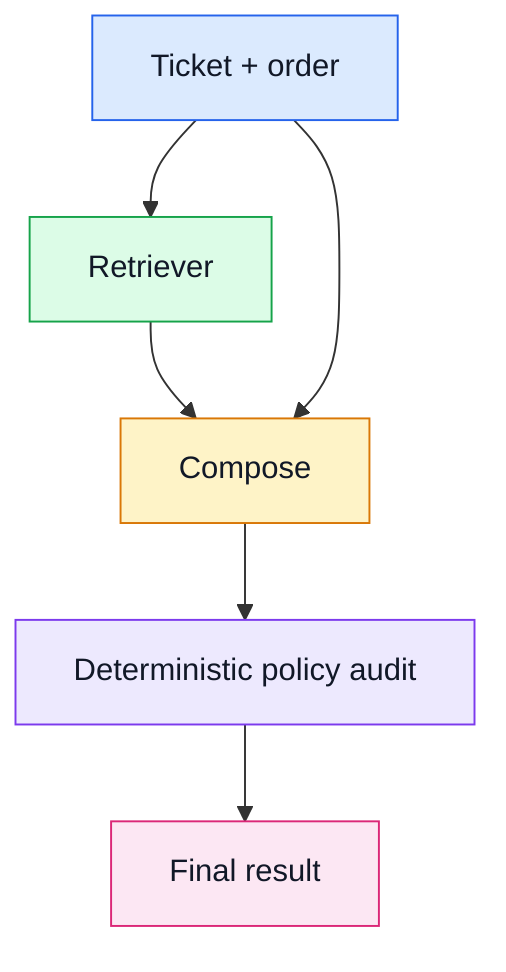
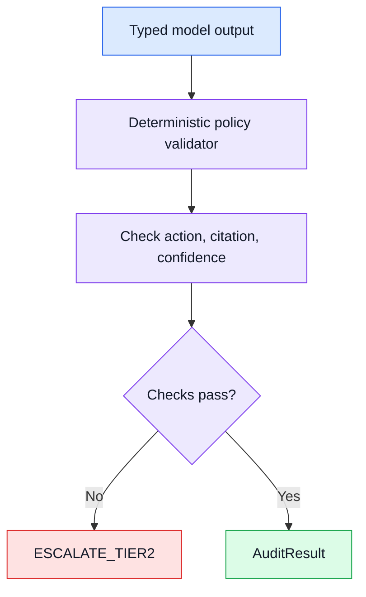

# Question 2 Submission

## Changes to `agent.py`

### Architecture-Based Changes

1. Multi-node pipeline with multiple LLM calls →
Triage/Retriever (local) → Compose (LLM) → Audit
(local)

2. 4 LLM Calls →
1 LLM Call

3. LLM-based KB article selection →
Local hybrid retriever using BM25 (lexical) and
embeddings (semantic) search with reciprocal rank fusion (RRF)

4. LLM-based audit →
Deterministic boundary rules from the KB articles

### Prompt Engineering

3. 4 redundant few shot examples →
2 concise examples
4. Verbose reasoning →
Only the required JSON
5. Run ID removed from the prompt
6.  Second triage call removed 

## Overall design

## Deterministic audit

Rules are defined from the KB articles in
[question2/rules.py](question2/rules.py).

## Per-call billing breakdown

Measured using the current implementation:

| Ticket | Points |
|---|---:|
| `T-1001` | 1,752 |
| `T-1002` | 1,623 |
| `T-1003` | 1,563 |
| `T-1004` | 1,524 |
| `T-1091` | 1,614 |
| **Average** | **1,615.2** |

Each ticket remains below the Question2 target of 2,500 points.
